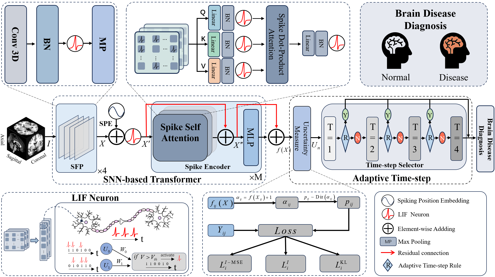

# UA-SNN

Official implementation of **UA-SNN: Uncertainty-aware Spiking Neural Networks with Adaptive Time Steps for Robust Brain Disease Detection**.

## Requirements

- Python 3.9
- PyTorch 1.13.0
- NumPy 1.23.0
- timm 0.6.12
- CuPy 13.3.0
- SpikingJelly 0.0.0.0.12
- MONAI
- SimpleITK 2.4.0
- scikit-learn
- TensorBoard

## Model

  

